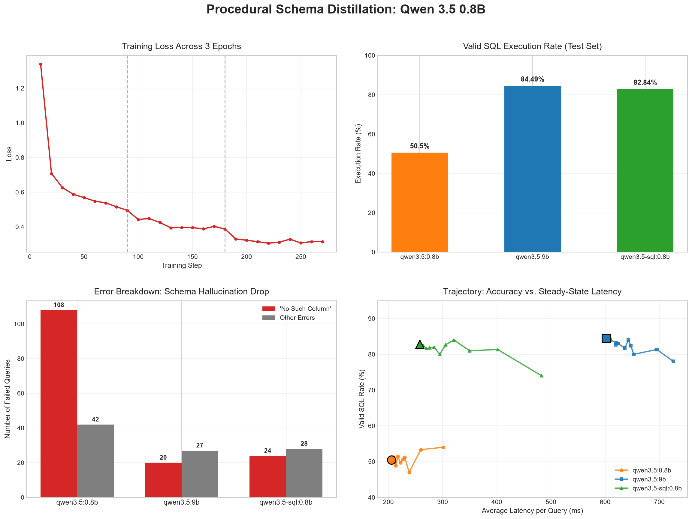

# Procedural Schema Distillation: Qwen 3.5 0.8B | Text-to-SQL
**Procedural Schema Distillation pipeline for Text-to-SQL tasks. By using Qwen 3.5 9B as a teacher, we fine-tune a Qwen 3.5 0.8B student to recover 95% of the teacher's accuracy while resolving multi-table JOIN hallucinations and running 2.3x faster.**



## Overview
Initial baseline testing of the **Qwen 3.5 0.8B** model on Text-to-SQL generation revealed a significant bottleneck: **72% of its failures were `no_such_column` errors** when attempting multi-table `JOIN` operations.<br>
**The Goal:** <br>Build an automated knowledge distillation pipeline to transfer complex, multi-table schema reasoning from a 9B parameter teacher model into a 0.8B parameter student model, achieving high execution validity while maintaining low VRAM usage and latency.

## Pipeline
*   **Teacher Model:** `qwen3.5:9b` (Ollama)
*   **Student Model:** `qwen3.5:0.8b` (Unsloth)
*   **Base Dataset:** `b-mc2/sql-create-context`
*   **Training Framework:** PyTorch & Unsloth (16-bit LoRA)<br>

**1. Procedural Data Distillation (`src/1_generate_dataset.py`)**
The base dataset was filtered to strictly contain complex schemas requiring at least one `JOIN` operation (2,001 total rows). The Teacher model generated SQL for 1,698 training rows. Importantly, an automated SQLite verification step was implemented to execute the Teacher's outputs against the schema, rejecting 268 invalid queries and ending up with **1,430 verified training examples**.

**2. Fine-Tuning (`src/3_train_lora.ipynb`)**
The verified JSONL dataset was used to fine-tune the 0.8B Student using Unsloth (LoRA, `r=16`, `alpha=32`). The model was trained for 3 epochs (270 steps) with a cosine learning rate scheduler and an `adamw_8bit` optimizer, then merged and exported to a 16-bit GGUF format for local serving.

## Benchmark Results
Evaluated against an unseen test pool of **303 multi-table queries**. Accuracy is defined by successful and valid execution against an SQLite database matching the provided DDL schema.

| Model | Parameters | Valid SQL Execution | Avg Latency | Column Hallucinations |
| :--- | :--- | :--- | :--- | :--- |
| **Qwen 3.5 (Student)** | 0.8B | 50.50% (153/303) | ~209 ms | 108 |
| **Qwen 3.5 (Teacher)** | 9B | 84.49% (256/303) | ~601 ms | 20 |
| **Qwen 3.5-SQL (Distilled)** | 0.8B | **82.84% (251/303)** | **~257 ms** | **24** |

**Key Takeaways:**
1. **Hallucination Resolution:** Schema-grounded distillation successfully reduced `no_such_column` errors by **78%**.
2. **Pareto Efficiency:** The distilled student matches the 9B teacher's execution rate (within 5 queries) while running **2.34x faster**.

## Repository Structure
```text
├── assets/                          # Visualizations and dashboard PNGs
├── data/                            # Distilled JSONL, train/test pools, and evaluation JSON logs
├── models/                          # Directory for compiled GGUF weights (ignored in .gitignore)
├── notebooks/
│   └── analysis_and_results.ipynb   # Matplotlib analysis dashboards
├── src/
│   ├── 1_generate_dataset.py        # Teacher inference & SQLite verification
│   ├── 2_evaluate_baseline.py       # Baseline benchmark execution
│   ├── 3_train_lora.ipynb           # Unsloth LoRA training
│   ├── 4_evaluate_distilled.py      # Distilled model benchmark execution
│   └── utils.py                     # SQL extraction, Ollama requests, and evaluation loops
├── pyproject.toml                   # Package management
└── README.md                        # Project documentation
```

## Reproduce
1. Install the environment dependencies:
   ```bash
   pip install -e .
   ```
2. Ensure Ollama is running locally on port `11434`.
3. To reproduce the evaluation metrics, run the evaluation scripts from the root directory:
   ```bash
   python src/2_evaluate_baseline.py
   python src/4_evaluate_distilled.py
   ```
*Note on Latency:* Initial benchmark data included Ollama's cold-start VRAM allocation penalty on the first query. src/utils.py has since been updated with a dummy warm-up request, meaning your local latency reproductions may average slightly faster than the published dashboard.

## License
This project and the distilled weights are licensed under the [Apache License 2.0](LICENSE).
